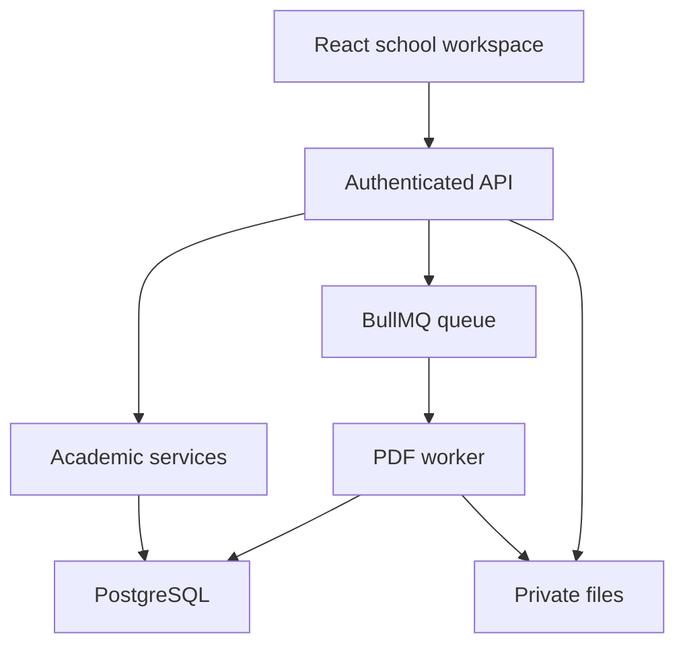

# Architecture

`lib/domain/academic.ts` owns validation, decimal averages, ranks, safe CSV and mapping geometry. Services in `lib/server/` own school setup, imports, coverage, decisions, snapshots and PDF generation. Route handlers validate request bodies and enforce role or assignment access.

Database adapters expose parameterized reads and atomic statement batches. PostgreSQL uses explicit transactions. Revision-guard statements fail the whole transaction after a competing change. Partial indexes enforce a single effective mark and active exception per enrollment/term/subject. Triggers protect approved snapshots and append-only history.

Native Next.js uses PostgreSQL, private files stored in the `object_blob` table and an optional BullMQ worker; this is the edition deployed to Vercel. Hosted Vinext uses D1 atomic batches and R2. Runtime selection is explicit; the hosted D1 database is not represented as PostgreSQL.

## Academic lifecycle

Staged/validated teacher rows commit to effective scores. Completeness checks precede calculation. READY runs require authorized approval. APPROVED snapshots are immutable; corrections create new score and result revisions. A final report batch references the approved result IDs and approved template version.

## Job lifecycle

Report metadata persists before queue insertion. The PostgreSQL worker scans queued/running jobs for restart recovery. Each section render claims a 120-second lease; batch/run uniqueness prevents duplicate output records. Once all sections exist, ZIP finalization writes a manifest and optional individual files. Failed jobs retain an error and can be retried. Queued/failed jobs can be cancelled.

Bounds are 12 sections and 500 students per section. ZIP finalization occurs in memory; larger streaming exports and lease/load testing remain necessary. Hosted jobs can resume through authenticated job visits when their background time budget expires.
