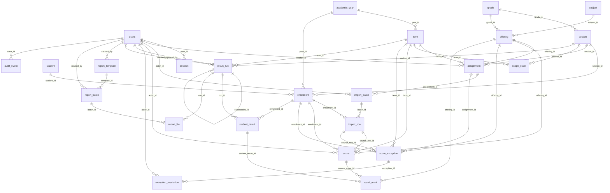

# Database relationships

Partial unique indexes, score bounds and immutable approved snapshots are enforced in SQL migrations. Decimal values use PostgreSQL NUMERIC(implementation unconstrained precision); Prisma models use Decimal.
